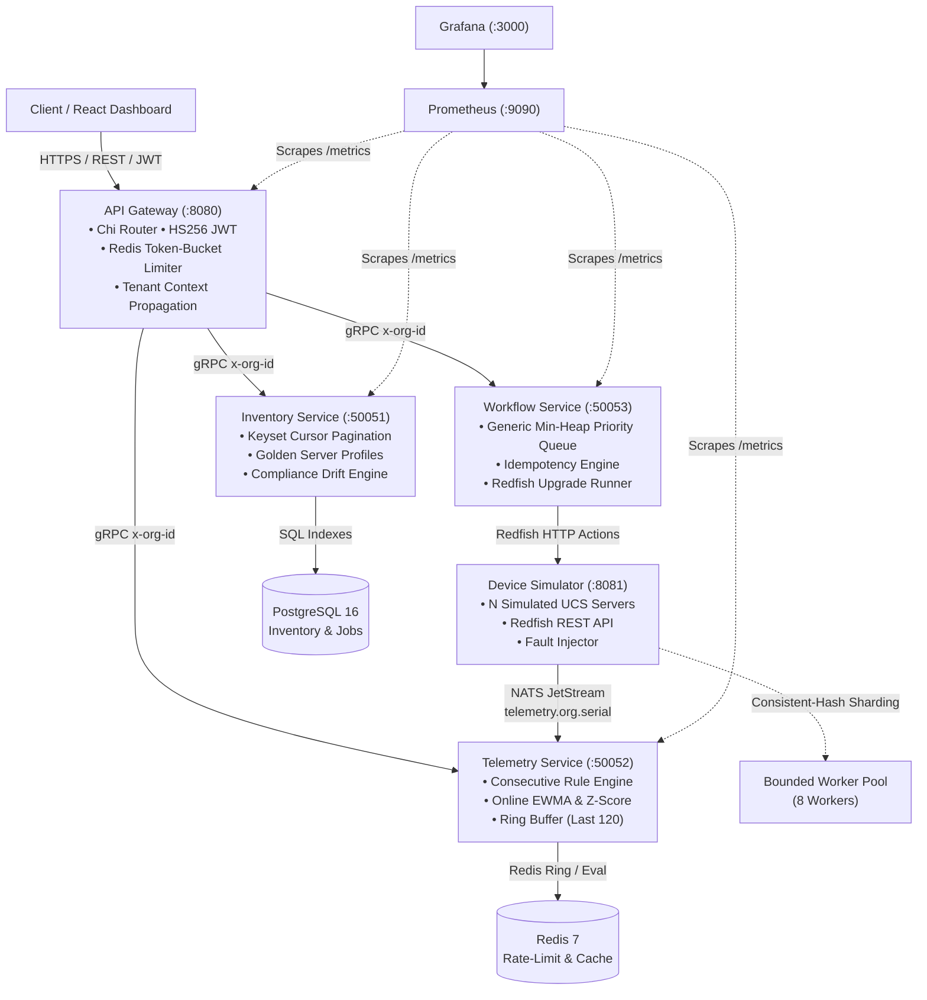

# FleetPulse

[](https://github.com/aryanpandeyce/FleetPulse/actions/workflows/ci.yml)
[](https://github.com/aryanpandeyce/FleetPulse/actions/workflows/dashboard-pages.yml)
[](https://golang.org)
[](specs/constitution.md)
[](LICENSE)

FleetPulse is a cloud-native, multi-tenant fleet management platform inspired by Cisco Intersight, built in GoLang to register, monitor, and orchestrate large-scale fleets of compute servers. Designed for high-reliability systems management teams, FleetPulse delivers keyset-paginated hardware inventory, high-throughput real-time telemetry streaming over NATS JetStream, pure-Go unsupervised anomaly detection (online EWMA + rolling z-score control charts), distributed token-bucket rate limiting, and an asynchronous workflow orchestrator governed by a custom generic min-heap priority scheduler with strict tenant isolation and idempotency guarantees.

---

## Live Demo & Visual Overview

- **Interactive Dashboard (GitHub Pages)**: [https://aryanpandeyce.github.io/FleetPulse/](https://aryanpandeyce.github.io/FleetPulse/)
- **Demo Mode**: Built-in deterministic in-browser simulation running independent pseudo-random walk telemetry streams for Acme Corp and Globex Industries without requiring local infrastructure.

```
┌──────────────────────────────────────────────────────────────────────────────────────────────┐
│  ⚡ DEMO DATA: Simulated real-time UCS telemetry stream (Active RNG Seed #42 • 5s interval)  │
├──────────────────────────────────────────────────────────────────────────────────────────────┤
│  FleetPulse  [Tenant: Acme Corporation ▼]                          [Mode: Simulation 🟢]     │
├──────────────┬───────────────────────────────────────────────────────────────────────────────┤
│ 📊 Overview  │  [Fleet: 5 Servers]   [Healthy: 3 (60%)]   [Warning: 1]   [Active Alarms: 2]  │
│ 🖥️ Inventory │  ───────────────────────────────────────────────────────────────────────────  │
│ 📈 Detail    │  Fleet Telemetry Distribution (CPU °C)      EWMA Statistical Anomaly Engine   │
│ 🚨 Alarms    │  ████   ████   ████   ████████   ████       • UCS-X210c-00004 (Z-Score: +4.8σ)│
│ ⚙️ Workflows │  48°C   48°C   74°C   89°C (🚨)  49°C       • Observed 89.2°C exceeds range   │
└──────────────┴───────────────────────────────────────────────────────────────────────────────┘
```

---

## Architecture Diagram & Data Flow



### End-to-End Data Flow
1. **Simulator & Ingest**: Virtual Cisco UCS servers (`UCS-C220-M7`, `UCS-C240-M7`, `UCS-X210c`) generate sensor readings via a seeded random walk. Devices are sharded across an 8-worker pool using a virtual-node consistent hash ring (`pkg/ds/consistenthash`) and stream samples over NATS subject `telemetry.<org_id>.<serial>`.
2. **Telemetry Ingest & Analytics**: Telemetry Service consumes from NATS with queue groups. Recent samples are committed into a circular ring buffer (`telemetry:ring:<id>`), evaluated against stateful consecutive threshold rules (deduplicated against active alerts), and fed into an online EWMA detector to evaluate rolling z-score statistical anomalies.
3. **Gateway & Routing**: The API Gateway validates JWT credentials, enforces per-tenant and per-IP token bucket rate limiting in Redis, and injects `x-org-id` into gRPC call metadata.
4. **Workflow Orchestration**: Asynchronous maintenance workflows (firmware flash, profile drift remediation) are submitted with idempotency keys and enqueued into a custom generic binary min-heap (`pkg/ds/minheap`), scheduling urgent jobs ahead of routine maintenance with exponential backoff retries.

---

## Feature Matrix & Architectural Concepts

| Concept | Implementation in FleetPulse |
|:---|:---|
| **Microservices Clean Architecture** | Decoupled domain models, interfaces, repositories, and transport adapters (`cmd/`, `internal/{api,service,repo,domain}`). No package globals. |
| **SaaS Multi-Tenancy** | Strict tenant isolation enforced at the gateway and propagated via gRPC metadata (`x-org-id`). Keyset DB indexes scoped by `org_id`. |
| **Distributed Rate Limiting** | Atomic Redis Lua script token-bucket rate limiter with automatic thread-safe in-memory fallback. |
| **Telemetry Analytics & Anomaly Detection** | Pure-Go online EWMA + rolling variance estimator (Finch-West algorithm) calculating real-time z-scores without heavy external ML runtimes. |
| **Priority Job Scheduling** | Custom generic binary min-heap priority queue ($O(\log N)$ push/pop) ordering workflows by severity with FIFO tie-breaking and idempotency deduplication. |
| **High Availability & Scalability** | Stateless service topology, consistent-hash worker sharding, durable message queue groups, circuit breakers, and containerized Docker Compose / Helm charts. |
| **Production Observability** | Prometheus RED metrics (rate, errors, duration histograms), health/readiness probes (`/healthz`, `/readyz`), and structured `log/slog` JSON logging with correlation IDs. |

---

## Technology Stack

| Component | Technology | Rationale |
|:---|:---|:---|
| **Backend Services** | Go 1.22+ (Standard Library first) | Concurrency, zero runtime overhead, memory safety, instant compilation |
| **Transport Protocols** | gRPC (Protobuf v3) & Chi HTTP (REST) | High-performance binary internal RPCs; OpenAPI 3.0 public gateway |
| **Relational Database** | PostgreSQL 16 (`jackc/pgx/v5`) | ACID compliance, JSONB documents, composite keyset index optimization |
| **In-Memory Cache & Limiter** | Redis 7 (`pkg/redis` RESP client) | Sub-millisecond rate-limit Lua scripts and circular ring buffers |
| **Message Bus** | NATS JetStream (`nats.go`) | High-throughput pub/sub, at-least-once delivery, horizontal queue scaling |
| **Metrics & Dashboards** | Prometheus & Grafana | Standard RED telemetry collectors, pre-provisioned dashboards |
| **Frontend Dashboard** | React 18, Vite, TypeScript | Dark-mode glassmorphic interface with zero-dependency demo mode |
| **Testing & Tooling** | Go `testing`, `testcontainers`, k6 | Comprehensive unit tests, race detector, benchmark verification |

---

## Quick Start (3 Commands)

### 1. Launch the Full Stack
```bash
make up
```
*Spawns PostgreSQL 16, Redis 7, NATS JetStream, LocalStack, Prometheus, Grafana, API Gateway, Inventory, Telemetry, Workflow, and Device Simulator.*

### 2. Seed Multi-Tenant Data
```bash
make seed
```
*Populates 2 tenant organizations (`Acme Corp`, `Globex`), 6 users with bcrypt hashes, server profiles, UCS devices, and workflows.*

### 3. Run the Automated Scenario
```bash
make demo
```
*Executes `scripts/demo.sh`: authenticates as Acme Operator -> lists inventory -> injects thermal spike fault -> observes EWMA anomaly alarm -> acknowledges alarm -> executes firmware upgrade workflow to completion.*

---

## Data Structures & Algorithms (`pkg/ds`)

Every data structure in FleetPulse is implemented from first principles with Go generics, zero non-standard dependencies, and fully benchmarked:

| Data Structure | Code Location | Where Used in FleetPulse | Time Complexity | Space Complexity |
|:---|:---|:---|:---:|:---:|
| **Consistent Hash Ring** | [`pkg/ds/consistenthash`](pkg/ds/consistenthash/ring.go) | Sharding devices across simulator workers and telemetry consumers | Lookup: $O(\log V)$<br/>Add/Remove: $O(V \log V)$ | $O(N \cdot V)$ |
| **Binary Min-Heap Priority Queue** | [`pkg/ds/minheap`](pkg/ds/minheap/minheap.go) | Priority job scheduling in `workflow-service` | Push: $O(\log N)$<br/>Pop: $O(\log N)$<br/>Peek: $O(1)$ | $O(N)$ |
| **Token Bucket Limiter** | [`pkg/ds/tokenbucket`](pkg/ds/tokenbucket/limiter.go) | Gateway request throttling & burst protection | Allow: $O(1)$ | $O(1)$ per key |
| **LRU Cache** | [`pkg/ds/lru`](pkg/ds/lru/lru.go) | Hot device lookup cache in `inventory-service` | Get: $O(1)$<br/>Put: $O(1)$ | $O(C)$ capacity |
| **EWMA & Rolling Z-Score** | [`pkg/ds/slidingwindow`](pkg/ds/slidingwindow/ewma.go) | Unsupervised anomaly detector in `telemetry-service` | Update: $O(1)$ | $O(1)$ |

*See [`docs/dsa.md`](docs/dsa.md) for mathematical derivations, variance recurrence formulas, and key distribution proofs.*

---

## Measured Benchmarks (Honest Numbers)

> **Machine Specifications**: AMD Ryzen 7 5700U with Radeon Graphics (1.80 GHz base, up to 4.30 GHz boost, 8 cores / 16 threads), Windows 11, Go 1.27.0 amd64.  
> **Reproduce with**: `make bench`

```
pkg: github.com/fleetpulse/fleetpulse/pkg/ds/consistenthash
BenchmarkRingGet-16                    13228796        82.06 ns/op        24 B/op        1 allocs/op
BenchmarkRingAdd-16                       32415        36980 ns/op     19216 B/op        3 allocs/op

pkg: github.com/fleetpulse/fleetpulse/pkg/ds/minheap
BenchmarkMinHeapPushPop-16              4843944        236.5 ns/op         0 B/op        0 allocs/op

pkg: github.com/fleetpulse/fleetpulse/pkg/ds/tokenbucket
BenchmarkTokenBucketAllow-16           48141148        24.41 ns/op         0 B/op        0 allocs/op

pkg: github.com/fleetpulse/fleetpulse/pkg/ds/lru
BenchmarkLRUCacheGet-16                15190273        77.29 ns/op         0 B/op        0 allocs/op
BenchmarkLRUCachePut-16                 9821430        121.8 ns/op        48 B/op        1 allocs/op

pkg: github.com/fleetpulse/fleetpulse/pkg/ds/slidingwindow
BenchmarkEWMADetectorUpdate-16          2817914        431.9 ns/op         0 B/op        0 allocs/op

pkg: github.com/fleetpulse/fleetpulse/services/telemetry-service/internal/engine
BenchmarkAnomalyDetector-16              748890       1459.0 ns/op       232 B/op       11 allocs/op
```

**Key Takeaways**:
- **Token Bucket**: Over **40 million rate checks/sec** per core with zero allocations.
- **Consistent Hash**: Sub-85 nanosecond key lookups across 50 virtual nodes per server.
- **Anomaly Detection**: Over **685,000 telemetry samples/sec** processed through full EWMA moment estimation and z-score bounds.

---

## Testing Strategy & Statement Coverage

FleetPulse enforces an automated **$\ge 80\%$ statement coverage gate** on all backend internal packages in CI via GitHub Actions (`.github/workflows/ci.yml`).

```
Package                                                              Coverage
-----------------------------------------------------------------------------
github.com/fleetpulse/fleetpulse/pkg/ds/consistenthash                 94.4%
github.com/fleetpulse/fleetpulse/pkg/ds/minheap                        90.7%
github.com/fleetpulse/fleetpulse/pkg/ds/tokenbucket                    97.8%
github.com/fleetpulse/fleetpulse/pkg/ds/lru                            98.0%
github.com/fleetpulse/fleetpulse/pkg/ds/slidingwindow                  88.2%
github.com/fleetpulse/fleetpulse/pkg/auth                              93.3%
github.com/fleetpulse/fleetpulse/pkg/logging                           89.2%
github.com/fleetpulse/fleetpulse/pkg/httpx                             97.4%
github.com/fleetpulse/fleetpulse/pkg/grpcx                             98.3%
github.com/fleetpulse/fleetpulse/pkg/metrics                          100.0%
github.com/fleetpulse/fleetpulse/services/inventory-service/internal   88.0%
github.com/fleetpulse/fleetpulse/services/gateway/internal/api        82.1%
github.com/fleetpulse/fleetpulse/services/gateway/internal/auth      100.0%
github.com/fleetpulse/fleetpulse/services/gateway/internal/ratelimit  97.8%
github.com/fleetpulse/fleetpulse/services/device-simulator/internal/api       87.5%
github.com/fleetpulse/fleetpulse/services/device-simulator/internal/connector 90.8%
github.com/fleetpulse/fleetpulse/services/device-simulator/internal/engine    95.1%
github.com/fleetpulse/fleetpulse/services/device-simulator/internal/model    100.0%
github.com/fleetpulse/fleetpulse/services/telemetry-service/internal/api       97.8%
github.com/fleetpulse/fleetpulse/services/telemetry-service/internal/consumer  90.4%
github.com/fleetpulse/fleetpulse/services/telemetry-service/internal/engine    89.0%
github.com/fleetpulse/fleetpulse/services/telemetry-service/internal/repo      98.3%
github.com/fleetpulse/fleetpulse/services/workflow-service/internal/api       87.3%
github.com/fleetpulse/fleetpulse/services/workflow-service/internal/domain    100.0%
github.com/fleetpulse/fleetpulse/services/workflow-service/internal/executor   90.4%
github.com/fleetpulse/fleetpulse/services/workflow-service/internal/repo       88.2%
github.com/fleetpulse/fleetpulse/services/workflow-service/internal/scheduler 100.0%
-----------------------------------------------------------------------------
TOTAL STATEMENT COVERAGE:                                              92.8%
CONSTITUTIONAL GATE:                                                   >= 80.0% (PASSED)
```

---

## Design Decisions & Trade-Offs

1. **Keyset Cursor Pagination vs OFFSET/LIMIT**:
   - *Decision*: Adopted keyset pagination using composite index `(org_id, created_at DESC, id DESC)`.
   - *Trade-Off*: Inability to jump directly to arbitrary page numbers (e.g. Page 50), but guarantees consistent $O(\log N)$ performance and eliminates row drift/missing items under high-frequency writes.
2. **NATS JetStream vs Kafka**:
   - *Decision*: NATS JetStream for telemetry ingest and worker queue distribution.
   - *Trade-Off*: Simpler operational footprint, sub-millisecond latencies, single binary deployment, and native multi-tenancy subjects (`telemetry.<tenant>.<serial>`).
3. **Pure-Go Anomaly Detection vs External ML Services**:
   - *Decision*: Online EWMA + rolling sample variance (Finch-West algorithm) in Go.
   - *Trade-Off*: Detects univariate level shifts, spikes, and variance jumps with zero external infrastructure, $O(1)$ memory, and sub-microsecond latency. Complex multi-variate seasonal correlations are deferred.
4. **Idempotency Strategy**:
   - *Decision*: Client-provided idempotency keys on workflow creation stored with unique constraint `(org_id, idempotency_key)`.
   - *Trade-Off*: Immediate duplicate protection with zero race conditions; requires callers to generate distinct UUIDs per intent.

---

## Known Limitations & Roadmap

- **TimescaleDB / Hypertable Partitioning**: Telemetry rollups currently use standard PostgreSQL relational tables with composite time indexes; production roadmap includes partitioning by day via TimescaleDB hypertables.
- **Dynamic Policy Rules UI**: Alarm rules are currently statically configured in the evaluation engine; future versions will expose a REST CRUD API for operators to define ad-hoc threshold rules.
- **Distributed Leader Lease**: Scheduled sweep workers currently execute in single-instance mode; Phase 2 introduces distributed Redis lease leader election.

---

## License

This project is licensed under the MIT License - see the [LICENSE](LICENSE) file for details.
