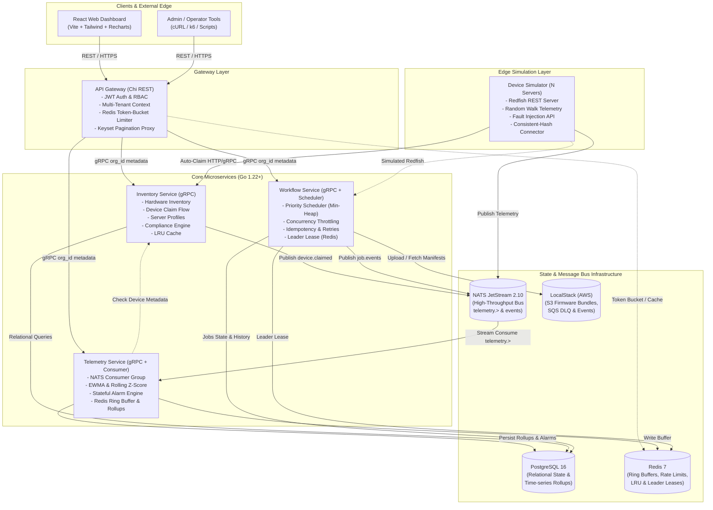
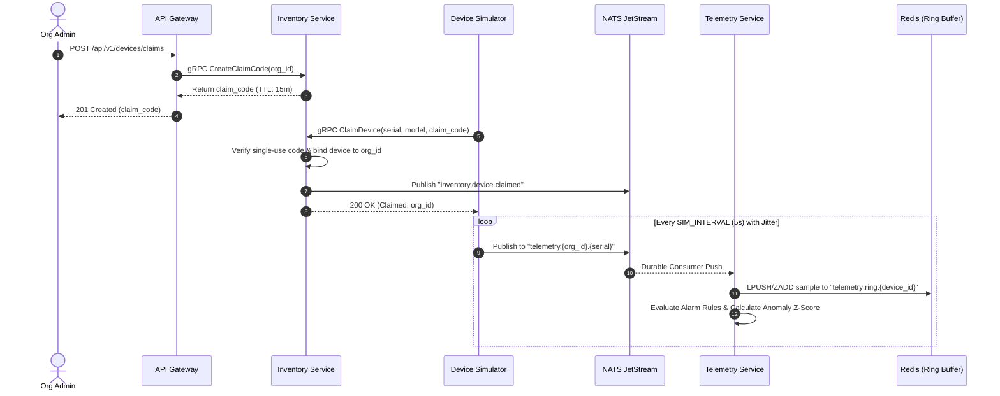
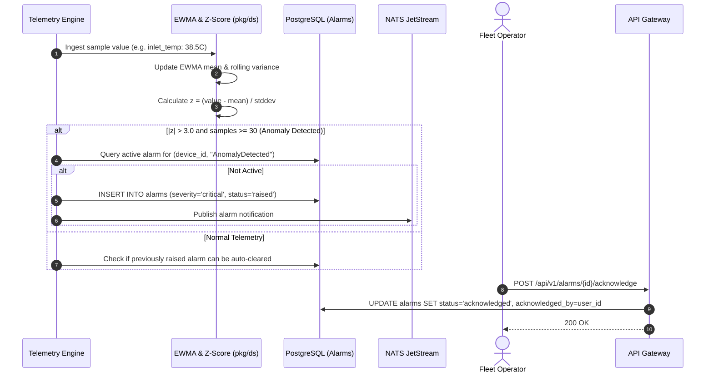

# FleetPulse Technical Architecture & Execution Plan

**Version:** 1.0.0  
**Status:** Approved  
**Classification:** Core System Architecture Document  

---

## 1. System Architecture Overview

FleetPulse is structured as a cloud-native, microservices-based distributed platform designed for horizontal scalability, multi-tenant isolation, and fault tolerance.

### 1.1 High-Level Component Architecture (Mermaid)



---

## 2. Technology Choices & Justification

### 2.1 Single Go Module vs. Go Workspace (`go.work`)
* **Decision:** **Single Go Module (`go.mod`) with clean internal package boundaries.**
* **Justification:** While multi-module Go workspaces offer independent versioning, they significantly complicate CI pipelines, dependency caching, local multi-container Docker image builds, and cross-package testing (`go test -race ./...`). A single root module with rigorous directory scoping (`pkg/` for shared libraries, `services/<name>/cmd` for binary entrypoints, and `services/<name>/internal` for private domains) guarantees atomic refactoring, zero version drift between internal services, fast reproducible builds, and seamless Docker container caching.

### 2.2 Inbound Routing: Chi vs. Gin vs. Fiber
* **Decision:** `github.com/go-chi/chi/v5`
* **Justification:** Chi is 100% compliant with standard `net/http` handlers and contexts (`http.HandlerFunc`). Unlike Fiber (which is based on Fasthttp and introduces context lifecycle incompatibilities) or Gin (which enforces custom context types and heavy abstractions), Chi allows seamless integration of standard middleware (CORS, Prometheus metrics, tracing, context propagation) with negligible memory allocation overhead.

### 2.3 Persistence: `pgx/v5` vs. GORM vs. `database/sql`
* **Decision:** `github.com/jackc/pgx/v5` (native connection pooling via `pgxpool`)
* **Justification:** GORM introduces hidden queries, reflection overhead, and unpredictable query generation for keyset cursor pagination and complex JSONB queries. `pgx` is the fastest PostgreSQL driver in Go, supports binary protocol encoding, native JSONB conversion, connection pool health checks, and explicit SQL query inspection (`EXPLAIN ANALYZE`).

### 2.4 Event Bus: NATS JetStream vs. Apache Kafka vs. RabbitMQ
* **Decision:** NATS JetStream (`nats.go`)
* **Justification:** NATS JetStream is written in Go, executes with single-digit millisecond latency, has a tiny memory footprint (<30MB RAM), and provides built-in persistence, stream de-duplication, subject-based filtering (`telemetry.<tenant>.<serial>`), durable consumer groups, and horizontal queue scalability without the operational weight or Zookeeper/KRaft complexity of Kafka.

### 2.5 Caching & In-Memory State: Redis 7
* **Decision:** `github.com/redis/go-redis/v9`
* **Justification:** Redis delivers sub-millisecond sorted sets (used for sliding window telemetry ring buffers), atomic Lua script execution for rate limiting, distributed leases for leader election, and low-latency caching.

---

## 3. Package Layout & Directory Structure

```
fleetpulse/
├── go.mod                      # Single root module: github.com/fleetpulse/fleetpulse
├── go.sum
├── Makefile                    # Standard developer workflows: build, test, lint, run, demo
├── specs/                      # Engineering constitution, specs, plan, task backlog, verification
│   ├── constitution.md
│   ├── spec.md
│   ├── plan.md
│   ├── tasks.md
│   └── verification.md
├── pkg/                        # Reusable foundational packages (Zero internal cross-imports)
│   ├── ds/                     # Core Data Structures & Algorithms
│   │   ├── consistenthash/     # Virtual-node consistent hash ring
│   │   ├── minheap/            # Generic binary priority min-heap
│   │   ├── tokenbucket/        # Atomic token-bucket rate limiter with mockable clock
│   │   ├── lru/                # Thread-safe doubly-linked list LRU cache
│   │   └── slidingwindow/      # EWMA, rolling variance, and z-score utilities
│   ├── auth/                   # JWT creation, claims validation, RBAC context helpers
│   ├── logging/                # slog structured JSON formatter with context propagation
│   ├── metrics/                # Standardized Prometheus metrics collectors (RED metrics)
│   ├── httpx/                  # Middleware (RequestID, Recovery, CORS, Timeout, RateLimit)
│   └── grpcx/                  # gRPC interceptors for org_id metadata, errors, metrics
├── api/
│   ├── proto/                  # Protobuf service definitions
│   │   ├── inventory.proto
│   │   ├── telemetry.proto
│   │   └── workflow.proto
│   └── openapi.yaml            # Public Gateway REST API contract (OpenAPI 3.0)
├── services/
│   ├── device-simulator/       # Simulated hardware fleet & connector
│   │   ├── cmd/main.go
│   │   └── internal/{api,model,engine,connector}
│   ├── gateway/                # Reverse proxy, auth, tenant isolation, rate limiter
│   │   ├── cmd/main.go
│   │   └── internal/{api,middleware,client,auth}
│   ├── inventory-service/      # Inventory, claims, profiles, compliance
│   │   ├── cmd/main.go
│   │   └── internal/{domain,repo,service,api}
│   ├── telemetry-service/      # Telemetry ingest, alarms, anomaly detection
│   │   ├── cmd/main.go
│   │   └── internal/{domain,consumer,engine,repo,api}
│   └── workflow-service/       # Job queue, min-heap scheduler, S3/SQS client, leader
│       ├── cmd/main.go
│       └── internal/{domain,scheduler,executor,repo,api}
├── deploy/
│   ├── docker-compose.yml      # Complete self-contained stack
│   ├── Dockerfile.*            # Multi-stage container builds
│   ├── helm/fleetpulse/        # Production Helm chart (HPA, PDB, Ingress)
│   ├── terraform/              # LocalStack AWS resources (S3, SQS)
│   └── grafana/                # Provisioned dashboard JSONs
├── dashboard/                  # React 18 + TypeScript + Vite + Tailwind + Recharts
├── loadtest/                   # k6 load testing scripts and recorded output
└── scripts/                    # Migration scripts, demo scenario runner, seed generator
```

---

## 4. Data Structures & Algorithms Analysis (`pkg/ds`)

| Data Structure / Algorithm | Package Path | Time Complexity | Space Complexity | Concrete Service Usage |
|---|---|---|---|---|
| **Consistent Hash Ring** | `pkg/ds/consistenthash` | Add Node: $O(V \log(N \cdot V))$\<br\>Lookup: $O(\log(N \cdot V))$ | $O(N \cdot V)$ where $N$=nodes, $V$=virtual nodes | Sharding 10,000 simulated servers across connector worker pools and telemetry consumer queue groups. |
| **Generic Binary Min-Heap** | `pkg/ds/minheap` | Push: $O(\log K)$\<br\>Pop: $O(\log K)$\<br\>Peek: $O(1)$ | $O(K)$ where $K$=queued jobs | Priority job scheduler in `workflow-service` ordering by priority and submission timestamp. |
| **Token Bucket Limiter** | `pkg/ds/tokenbucket` | Take/Allow: $O(1)$ | $O(1)$ per bucket | API Gateway rate limiting per tenant and per IP, executed in-memory and via Redis Lua scripts. |
| **Thread-Safe LRU Cache** | `pkg/ds/lru` | Get: $O(1)$\<br\>Put: $O(1)$\<br\>Evict: $O(1)$ | $O(C)$ where $C$=capacity | Hot device metadata and server profile cache in `inventory-service`. |
| **EWMA & Rolling Z-Score** | `pkg/ds/slidingwindow` | Update: $O(1)$\<br\>Z-Score: $O(1)$ | $O(W)$ where $W$=warm-up window | Real-time anomaly detection in `telemetry-service` tracking sensor deviations without recomputing historical points. |

---

## 5. Component Interaction & Sequence Diagrams

### 5.1 Device Claim & Telemetry Streaming Sequence (Mermaid)



### 5.2 Anomaly Detection & Stateful Alarm Sequence (Mermaid)



### 5.3 Workflow Execution & Rolling Batch Upgrade (Mermaid)

```mermaid
sequenceDiagram
    autonumber
    actor Operator as Fleet Operator
    participant GW as API Gateway
    participant WF as Workflow Service
    participant HEAP as Min-Heap Priority Queue
    participant SIM as Device Simulator (Redfish)
    participant DB as PostgreSQL (Jobs)

    Operator->>GW: POST /api/v1/workflows (type="firmware_upgrade", priority=1, targets=[...])
    GW->>WF: gRPC CreateJob(org_id, idempotency_key, ...)
    WF->>DB: Check idempotency_key
    WF->>DB: INSERT INTO workflow_jobs (state='queued')
    WF->>HEAP: Push job into Min-Heap
    WF-->>GW: 201 Created (job_id)
    GW-->>Operator: Return Job Details

    loop Scheduler Loop (Worker Pool)
        WF->>HEAP: Pop highest priority job
        WF->>DB: UPDATE workflow_jobs SET state='running'
        
        loop Batches of Size B
            WF->>SIM: POST /redfish/v1/Systems/{serial}/Actions/FirmwareUpdate
            SIM-->>WF: 202 Accepted (Task URI)
            loop Poll until complete
                WF->>SIM: GET /redfish/v1/TaskService/Tasks/{id}
                SIM-->>WF: Progress % / State
            end
            alt Batch Failure Rate > max_failure_percent
                WF->>DB: UPDATE workflow_jobs SET state='failed' (Aborted)
                break
            end
        end

        WF->>DB: UPDATE workflow_jobs SET state='succeeded'
    end
```

---

## 6. Failure Modes & Resilience Strategies

| Failure Mode | Impact | Detection | Automatic Recovery Strategy |
|---|---|---|---|
| **Redis Node Outage** | Rate limiting and ring buffer caching unavailable. | Connection timeout in Redis client. | Gateway falls back to local in-memory token bucket; telemetry service continues batching writes straight to PostgreSQL rollups. |
| **PostgreSQL Transient Failure** | Relational queries and write operations fail. | `pgxpool` ping failures and error returns. | gRPC clients retry with exponential backoff; telemetry service buffers rollups in memory; circuit breaker opens to prevent thundering herd. |
| **NATS Broker Failure / Partition** | Telemetry ingestion and event publishing stalled. | Disconnect event in `nats.go` connection handler. | Simulator connector buffers samples locally up to memory limit; reconnects automatically with exponential backoff and publishes upon restoration. |
| **Workflow Worker Crash** | In-flight jobs left in `running` state indefinitely. | Startup sweep and periodic leader lease heartbeat. | Leader election sweeper discovers jobs in `running` state with `updated_at` older than threshold (5m) and re-enqueues them with incremented attempt count. |
| **Split-Brain Leader Sweeper** | Multiple instances attempt to run scheduled reconciliations. | Expired leases or competing lock acquisition. | Distributed lock via Redis key with monotonic fence token and short TTL (10s), renewed every 3s. PostgreSQL advisory locks as secondary guard. |
| **Slow Telemetry Consumer** | Telemetry queue accumulates lag under load storm. | Prometheus metric `ingest_lag_seconds`. | JetStream queue groups scale horizontally across multiple telemetry-service pods; consistent-hash sharding distributes partitions. |
